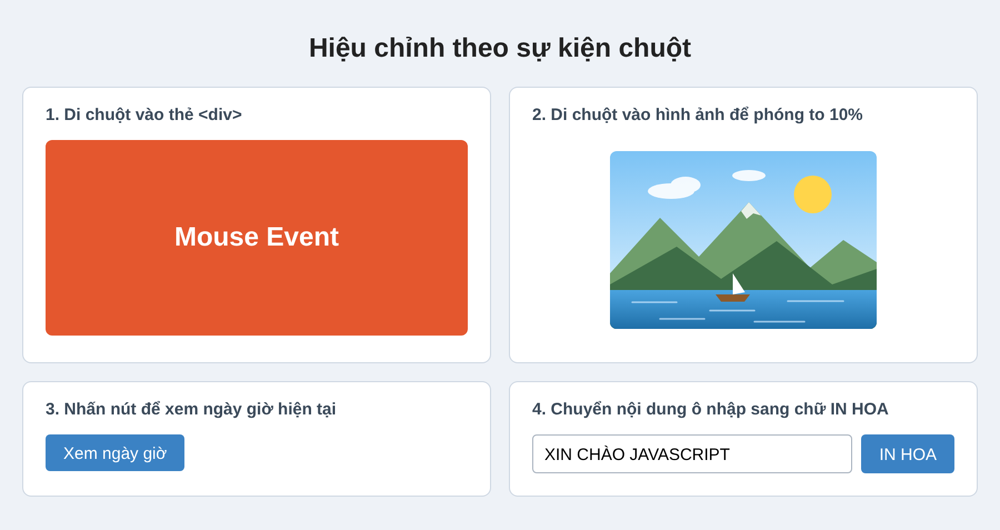

# Bài 3.2.1 – Hiệu chỉnh theo sự kiện chuột

Bài tập JavaScript (truy xuất DOM) trong sách *Bài tập Thiết kế Web*, mục **3.2.1. Hiệu chỉnh theo sự kiện chuột**.

## Kết quả



## Yêu cầu

Dùng lệnh DOM của JavaScript để tạo hiệu ứng chuột trên các đối tượng:

1. Đổi nội dung thẻ `<div>` từ **"Hover Me"** sang **"Mouse Event"** khi di chuột vào thẻ.
2. Tăng kích thước hình ảnh thêm **10%** khi di chuột vào thẻ ``.
3. Hiện thông báo ngày giờ hiện tại khi nhấn nút.
4. Chuyển nội dung trong ô nhập (textbox) sang chữ **IN HOA**.

Khi chuột rời đi, nội dung thẻ `<div>` và kích thước ảnh trở lại như cũ để có thể thử lại nhiều lần.

## Cấu trúc

```
js-su-kien-chuot/
├── index.html       # 4 khung cho 4 yêu cầu
├── style.css
├── script.js        # xử lý các sự kiện chuột
├── phong-canh.svg   # hình ảnh dùng cho hiệu ứng phóng to
└── screenshot.png   # ảnh kết quả
```

## Kiến thức JavaScript sử dụng

- `document.getElementById` để lấy phần tử
- `addEventListener` với các sự kiện `mouseover`, `mouseout`, `click`
- Đổi nội dung thẻ bằng `innerHTML`, đổi màu bằng `classList`
- Đổi kích thước ảnh qua thuộc tính `width`: bề rộng gốc × 1.1
- Đối tượng `Date`: `getDate()`, `getMonth()`, `getFullYear()`, `getHours()`, `getMinutes()`, `getSeconds()`, `getDay()`; hiện thông báo bằng `alert()`
- `toUpperCase()` để chuyển chuỗi sang chữ in hoa

## Cách chạy

Tải repo về (**Code → Download ZIP**), mở file `index.html` bằng trình duyệt rồi rê chuột hoặc bấm vào từng khung.
